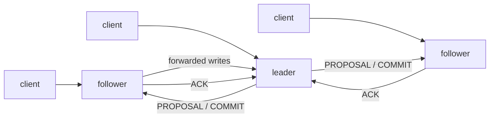

# ZooKeeper in Go

[](https://github.com/Dogukan-Bayhan/zookeeper/actions/workflows/ci.yml)
[](go.mod)

**Türkçe:** [README.tr.md](README.tr.md)

A from-scratch implementation of **Apache ZooKeeper's design** in Go, following the paper
[*ZooKeeper: Wait-free coordination for Internet-scale systems*](https://www.usenix.org/legacy/event/atc10/tech/full_papers/Hunt.pdf)
(Hunt, Konar, Junqueira, Reed — USENIX ATC 2010). It includes a replicated coordination
service, a client library, the coordination recipes from the paper, five real-world
applications built on top of them, and an **interactive web lab** where you can build a
cluster node by node, crash nodes and processes, and watch every step in the logs.

About 9,500 lines of Go plus 1,600 lines of tests, with no dependencies beyond the standard
library. All 28 tests run with the race detector in CI.

---

## Highlights

- **Replicated service with a Zab-style atomic broadcast**: leader election, discovery
  (new epoch), synchronization (DIFF/SNAP) and broadcast (PROPOSAL → ACK → COMMIT).
  Linearizable writes; reads are served locally and scale with the number of servers.
- **Paper's guarantees enforced and tested.** Linearizable writes, FIFO client order with
  pipelined async requests, watch notification before the new state is visible, `sync` for
  slow reads, and a client that never moves to a server older than what it has seen.
- **Durability.** CRC-checked write-ahead log forced to disk before every ACK. Fuzzy
  snapshots taken without blocking writers. Recovery relies on idempotent transactions.
- **Sessions and ephemeral znodes.** The leader expires sessions. Clients send heartbeats
  and fail over to another server with their watches re-registered.
- **Recipes from §2.4**: configuration, rendezvous, group membership, locks (simple and
  herd-free), read/write locks, double barrier, leader election.
- **Five applications** showing why coordination services exist: live configuration,
  service discovery + load balancing over real HTTP servers, an HA job scheduler, a
  lock-protected ticket store (oversells without the lock), and a work queue that survives
  worker crashes.
- **Observability.** Structured, levelled logs of every step on every node, streamed live
  to a web UI that also shows each node's replica of the znode tree.
- **Docker.** One-command web lab, or a real multi-container ensemble with persistent
  volumes.

## Quick start

### Web lab (recommended)

```sh
docker compose up -d --build        # or: go run ./cmd/zkapp web
# open http://localhost:8080
```

1. Start with **1 node** or a **3-node cluster**, then grow it with **+ Add node**.
2. Pick an operation from the list: create/read/update/delete znodes, set watches, start
   services, gateways, schedulers and workers, crash the leader, or run a ready-made
   scenario.
3. Follow it in the **Logs** tab: every node logs each change it applies to its replica
   (`✎ znode created in local replica … zxid=2:5`). Set node logs to *debug* in Settings
   to see PROPOSAL → ACK → COMMIT. Use the **Znode tree** tab to compare the replicas of
   different nodes.

### Distributed setup with Docker

Every ZooKeeper server and every application runs in its own container:

```sh
docker compose --profile cluster up -d --build
docker compose --profile cluster logs -f zk1 zk2 zk3 gateway scheduler-1 scheduler-2
docker compose --profile cluster stop zk3      # kill a server (try the leader)
docker compose --profile cluster start zk3     # it recovers from its WAL and catches up
docker compose run --rm cli zkapp config-set rateLimit=75
docker compose run --rm cli zkapp tree /
docker compose --profile cluster down -v
```

### From source

```sh
go test -race ./...                  # everything, including end-to-end scenarios
go run ./cmd/zkapp demo              # scripted tour of all scenarios in the terminal
go run ./cmd/zkapp cluster           # 3 servers on 127.0.0.1:2181-2183, then in other terminals:
go run ./cmd/zkapp service -name api-1
go run ./cmd/zkapp gateway
go run ./cmd/zkapp scheduler -name s1
```

### Using the library

The project is meant to be cloned and run, not imported as a dependency:

```sh
git clone https://github.com/Dogukan-Bayhan/zookeeper.git
cd zookeeper
```

Inside the repository the packages are imported as `zookeeper/...`:

```go
import (
    "zookeeper/client"
    "zookeeper/recipes"
    "zookeeper/zk"
)

c, err := client.Connect(client.Config{
    Servers:        []string{"127.0.0.1:2181", "127.0.0.1:2182", "127.0.0.1:2183"},
    SessionTimeout: 10 * time.Second,
})
defer c.Close()

c.Create("/app", []byte("v1"), zk.FlagPersistent)
data, stat, changed, _ := c.GetDataW("/app")          // one-time watch
c.SetData("/app", []byte("v2"), stat.Version)         // conditional update
<-changed                                              // EventNodeDataChanged

c.CreateAsync("/app/job-", nil, zk.FlagSequential, func(name string, err error) {})
c.Sync("/app")                                         // read-after-write across clients

lock := recipes.NewLock(c, "/locks/db")                // herd-free distributed lock
lock.Lock(ctx); defer lock.Unlock()
```

## Architecture



Clients connect to any server. Reads are answered from that server's in-memory replica.
Writes go to the leader, which converts them into **idempotent transactions** validated
against the future state, logs them, and broadcasts them. Once a quorum has logged a
transaction, it is committed and applied in zxid order on every server. See
**[docs/ARCHITECTURE.md](docs/ARCHITECTURE.md)** for the write path, `sync`, watches,
WAL and recovery, Zab phases, sessions and the testing strategy.

| Package | What it contains |
|---|---|
| [`server`](server) | replicated server: data tree, request processor, election, Zab leader/follower, sessions, watches, WAL + fuzzy snapshots |
| [`client`](client) | client library: sync and async API, FIFO callbacks, heartbeats, failover, watch re-registration |
| [`recipes`](recipes) | coordination primitives from §2.4 of the paper, client-side only |
| [`app`](app) | real-world applications and the scripted demo |
| [`web`](web) | web lab: HTTP API, server-sent event log stream, embedded single-page UI |
| [`zlog`](zlog) | `log/slog` handler for coloured, component-tagged terminal logs |
| [`transport`](transport) | message-oriented FIFO connections: TCP (gob) and an in-process network for tests |
| [`zk`](zk) | shared types and wire protocol |
| [`cmd`](cmd) | `zkapp` (lab, demo, apps), `zkserver`, `zkcli` |

## Paper → code

| Paper | Implementation |
|---|---|
| §2.1 znodes: regular, ephemeral, sequential; watches | `server/datatree.go`, `server/watches.go` |
| §2.2 API, sync and async | `client/client.go` |
| §2.3 linearizable writes, FIFO client order, `sync` | `server/session.go`, `leaderSync` in `server/leader.go` |
| §2.4 primitives | `recipes/` |
| §4.1 request processor, idempotent transactions | `server/prep.go` |
| §4.2 atomic broadcast (Zab) | `server/leader.go`, `server/follower.go`, `server/election.go` |
| §4.3 replicated database, fuzzy snapshots | `server/datatree.go`, `takeSnapshot` in `server/server.go`, `server/storage.go` |
| §4.4 client–server interactions, sessions, heartbeats | `server/session.go`, `client/client.go` |

## Testing

```sh
go test -race ./...
```

- **Data tree:** idempotent replay; the paper's fuzzy-snapshot example (`/foo`, `/goo`)
  replayed exactly; recovery from a torn WAL record.
- **Ensembles of 1, 3 and 5 servers:** replication with replica digests compared;
  watch semantics and ordering; session expiry; 500 pipelined async calls in FIFO order;
  `sync`; leader failover with live sessions; follower catch-up by DIFF and by SNAP;
  full-ensemble restart from storage; loss of quorum; session moves with watch
  re-registration; a TCP ensemble.
- **Applications, end to end:** every scenario with injected failures. Assertions include
  no overselling, never two active leaders, and no lost jobs.

## Limitations

ACLs, quotas, multi-op transactions and dynamic reconfiguration are not implemented. Adding
a node restarts the others, as in ZooKeeper before 3.5. Leader election is a simplified
voting protocol, and the Zab implementation follows the published phases but is not
formally verified. This is an educational, paper-faithful implementation, not a drop-in
replacement for Apache ZooKeeper.

## Copyright

© 2026 Dogukan Bayhan. All rights reserved. You may browse, clone and run this repository to
evaluate it. No license is granted to reuse, modify or redistribute the code.
