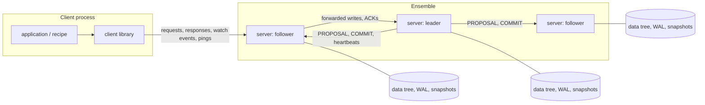
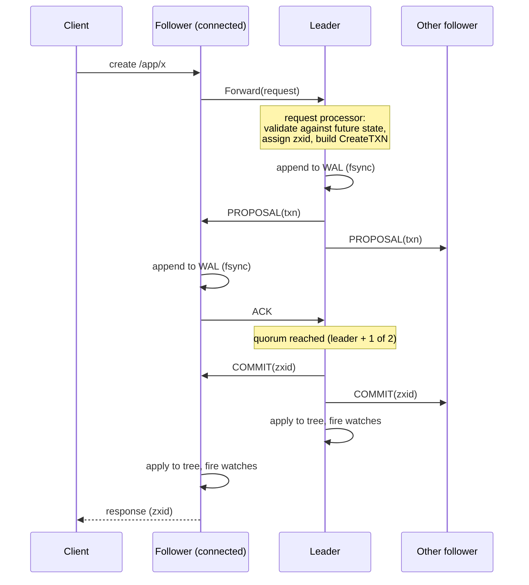

# Architecture

This document explains how the implementation maps to the design described in
*ZooKeeper: Wait-free coordination for Internet-scale systems* (Hunt, Konar,
Junqueira, Reed — USENIX ATC 2010), and the decisions taken where the paper
leaves details open.

- [Components](#components)
- [Write path](#write-path)
- [Read path, `sync` and watches](#read-path-sync-and-watches)
- [Durability: write-ahead log, fuzzy snapshots, recovery](#durability-write-ahead-log-fuzzy-snapshots-recovery)
- [Leader election and Zab](#leader-election-and-zab)
- [Sessions](#sessions)
- [Client library](#client-library)
- [Recipes and applications](#recipes-and-applications)
- [Testing strategy](#testing-strategy)
- [Known simplifications](#known-simplifications)

## Components

Each server (`server/`) contains the components of Figure 4 in the paper:

| Component | File | Responsibility |
|---|---|---|
| Request processor | `server/prep.go` | turns a client write into an **idempotent transaction** computed against the *future* state |
| Atomic broadcast | `server/leader.go`, `server/follower.go` | Zab-style discovery, synchronization and broadcast |
| Leader election | `server/election.go` | round-based voting on `(epoch, zxid, id)` |
| Replicated database | `server/datatree.go` | in-memory tree of znodes plus the session table |
| Durability | `server/storage.go` | write-ahead log, snapshots, epochs (`FileStorage`, `MemStorage`) |
| Sessions and watches | `server/session.go`, `server/watches.go` | per-client FIFO pipeline, local watch tables |

## Write path

**Idempotent transactions (§4.1).** The leader does not broadcast the
operation; it broadcasts its *result*: a `SetDataTXN` carries the new data and
the new version, a `CreateTXN` carries the final (sequential) name and the new
parent `cversion`. Applying a transaction twice therefore yields the same
state, which is what makes fuzzy snapshots and re-delivery during recovery
safe. Validation runs against **change records** layered over the committed
tree, so a pipeline of outstanding writes (e.g. two `create`s of the same
path) is judged against the state they will produce, not the stale committed
state. Failed validations become an `ErrorTXN` that is broadcast like any
other transaction, so errors are returned in FIFO order too.

**Ordering.** Proposals are committed strictly in zxid order (`tryCommit`
only commits the head of the queue). TCP gives FIFO delivery per connection;
followers additionally check that proposals are contiguous
(`counter == last + 1`, or `1` in a new epoch) and resynchronize otherwise.

**Who answers the client.** The server the client is connected to answers when
*it* applies the transaction (§4.2), so a client can never receive a write
acknowledgement and then read an older state from the same server.

## Read path, `sync` and watches

Reads are served from the local replica without any coordination — this is
why read throughput scales with the number of servers. Each response carries
the zxid of the replica state it reflects.

- **FIFO client order (§2.3).** A session's requests are queued in order on the
  server (`clientSession.pending`). Writes are pipelined to the leader; a read
  is executed only when everything before it in the session queue has
  completed. A client therefore always reads its own writes.
- **`sync` (§4.4).** A sync is sent to the leader and placed behind the
  outstanding proposals. The leader replies right after the last pending
  `COMMIT` on the same FIFO connection, so by the time the follower answers,
  it has applied everything committed before the sync. No transaction is
  broadcast for it. `sync` followed by a read is a "slow read".
- **Watches (§2.1).** Watches are one-time triggers kept only by the server the
  client is connected to. Notifications are queued on the client connection
  while the database write lock is held, so a client sees the notification
  *before* any response reflecting the new state. When a client moves to
  another server it sends its watch list with its last seen zxid; the new
  server re-registers them and immediately fires those whose znode changed in
  between.

## Durability: write-ahead log, fuzzy snapshots, recovery

**Write-ahead log.** Every proposal is appended to the transaction log and,
with `FileStorage`, forced to the disk (`fsync`) **before** the follower sends
its ACK or the leader counts its own vote (§4). A record is
`[length uint32][CRC-32 uint32][gob-encoded txn]`. On startup the log is
scanned and a torn or corrupt tail (crash in the middle of a write) is
discarded.

**Fuzzy snapshots (§4.3).** Every `SnapCount` transactions (10 000 by
default) a background goroutine walks the tree depth-first, taking the read
lock only while copying one znode. Writes keep flowing meanwhile, so the
snapshot may not correspond to any real state. It records the zxid at which
it started; replaying the log from that zxid fixes it because transactions are
idempotent. `server/datatree_test.go` replays the paper's own `/foo`–`/goo`
example. After a snapshot the log is compacted, keeping one snapshot
interval of history so that slightly lagging followers can still catch up
with a diff.

**Recovery.** On restart a server

1. loads the latest snapshot (its zxid becomes `lastCommitted`),
2. reads the log; the last entry gives `lastLogged`, which is its vote in the
   election,
3. leaves logged-but-not-yet-committed entries unapplied until the new leader
   tells it what is committed (`NEWLEADER` with a commit zxid), or — if it
   becomes the leader itself — commits its whole history, which is the most
   recent of the quorum.

The epochs (`acceptedEpoch`, `currentEpoch`) are persisted separately and
are required by Zab's safety argument. The Docker cluster uses `FileStorage`
on volumes; killing every container and starting them again restores the
data. The in-process lab uses `MemStorage`, which survives a node crash and
restart (the storage object is kept) but not a restart of the lab process.

## Leader election and Zab

**Election.** A looking server proposes itself with its `(currentEpoch,
lastLoggedZxid, id)` and adopts any better vote it hears; once a quorum agrees
it waits a short finalization window for late better votes. A server that is
already following or leading answers lookers with its leader, so a recovering
server simply joins the established ensemble.

**Discovery.** Followers send their accepted epoch; the leader picks
`max + 1`, followers accept it and report their history. If a follower turns
out to have a more recent history, the leader abandons leadership.

**Synchronization.** For each follower the leader sends either a **DIFF** (the
transactions after the follower's last zxid, if that zxid is in the leader's
log) or a **SNAP** (a consistent snapshot plus in-flight proposals) when the
follower's history diverged or is older than the retained log. `NEWLEADER`
carries the commit point; once a quorum has acknowledged it the leader starts
broadcasting and sends `UPTODATE`, after which followers serve clients.
Followers joining later go through the same steps while broadcast continues.

**Failure detection.** The leader pings followers every tick and steps down
if it does not hear from a quorum within `syncLimit` ticks; followers abandon
a silent leader after `2 × syncLimit`, so a deposed leader stops serving
before a new one can be elected (the property the paper relies on for `sync`
without a null transaction). When a server leaves the serving state it drops
its client connections; clients reconnect elsewhere.

## Sessions

- Sessions are replicated: creating and closing a session are transactions,
  so every server knows the live sessions and their ephemeral znodes.
- Any server touching a session reports it to the leader in its heartbeat
  replies; the **leader** expires sessions not heard of within their timeout
  and broadcasts a `CloseSessionTXN` that deletes their ephemeral znodes.
- The client sends a heartbeat after `s/3` of idleness and switches server
  after `2s/3` of silence (§4.4). A server refuses a session whose last seen
  zxid is newer than its own state, so a client never goes back in time.

## Client library

`client/` exposes every operation in synchronous and asynchronous form.
Callbacks and watch events are delivered by a single dispatcher goroutine in
arrival order, extending the FIFO guarantee to the application. Requests
issued while disconnected are queued and sent on reconnection; requests in
flight when a connection breaks fail with `ErrConnectionLoss` (their outcome
is unknown, as in ZooKeeper). Data passed to the API is copied.

## Recipes and applications

`recipes/` implements the primitives of §2.4 using only the public client
API: configuration, rendezvous, group membership, simple locks, locks without
herd effect (each waiter watches only its predecessor), read/write locks,
double barriers and leader election.

`app/` builds realistic applications on top of them — live configuration,
service discovery with a load-balancing gateway over real HTTP servers, a
highly available scheduler, a lock-protected ticket store, and a work queue
whose jobs survive worker crashes — each runnable as a separate process, in
the scripted demo, or from the web lab.

## Testing strategy

- **Unit tests** for the data tree: idempotent replay, the paper's fuzzy
  snapshot example, torn WAL tails.
- **Ensemble tests** (`tests/`) run 1, 3 and 5 servers over an in-process
  network: replication and convergence of replica digests, watches and their
  ordering guarantee, session expiry, 500 pipelined async operations in FIFO
  order, `sync`, leader failover with live sessions, follower recovery by DIFF
  and by SNAP, full-ensemble restart from storage, loss of quorum, session
  moves with watch re-registration, and an ensemble over real TCP.
- **Scenario tests** (`app/demo_test.go`) run every application end to end,
  including crashed processes and a crashed leader, and assert outcomes (no
  overselling, never two active leaders, no lost jobs…).
- Everything runs with the **race detector** in CI.

## Known simplifications

- No ACLs, quotas, multi-op transactions or dynamic reconfiguration; adding
  or removing a member requires restarting the others (as in ZooKeeper before
  3.5).
- Leader election is a simplified voting protocol; Zab is implemented
  following the published phases but is not formally verified.
- One TCP connection per client and per follower; no request throttling or
  batching of fsyncs (group commit).
